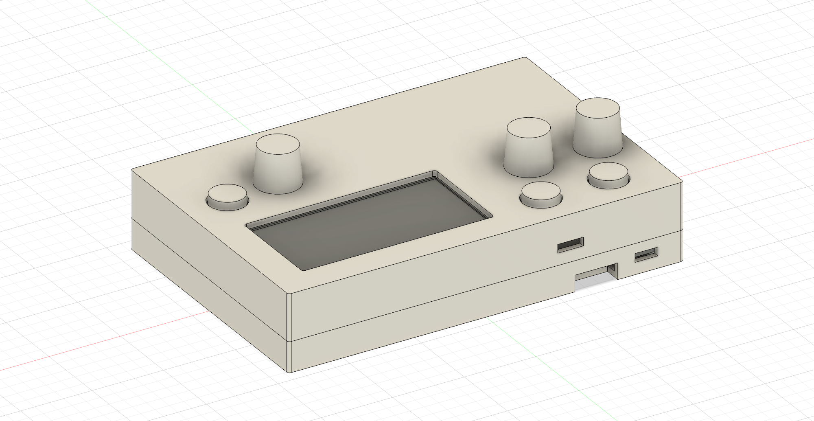
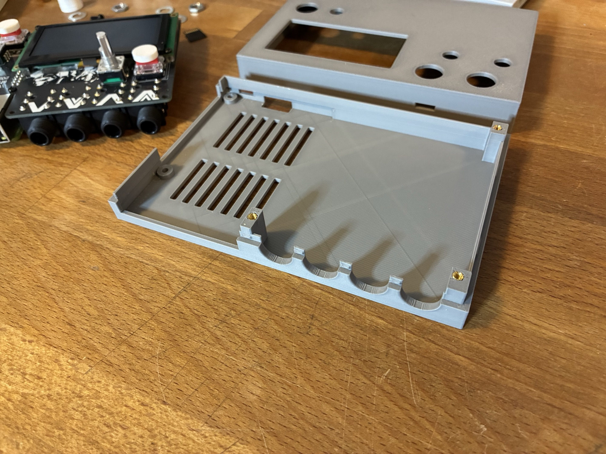
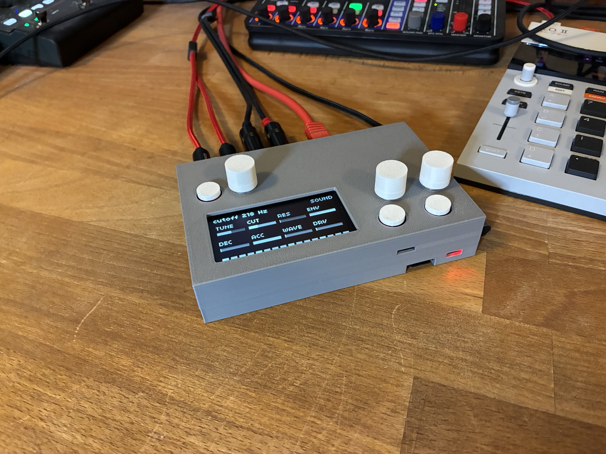

# shieldXL case

A 3D-printable, two-part snap-fit case for the [shieldXL](https://github.com/okyeron/shieldXL) (a Raspberry Pi 4 based norns shield), with knobs, button caps and audio jack nuts. Designed in Autodesk Fusion, printed in PLA on a Bambu Lab A1.

## Parts

All files are in `exports/`, in millimeters.

| Part | Qty | Size (mm) | File |
| --- | --- | --- | --- |
| Bottom | 1 | 138 x 92 x 16.8 | `shieldXL_case_Bottom.3mf` |
| Top | 1 | 138 x 92 x 16.3 | `shieldXL_case_Top.3mf` |
| Knob | 3 | 15 / 13 diameter x 13 tall | `shieldXL_case_Knob.3mf` |
| Button cap | 3 | 12 / 11.5 diameter x 6 tall | `shieldXL_case_Button_Cap.3mf` |
| Audio jack nut | 4 | 14 across flats x 3.2, 3/8-32 UNEF thread | `shieldXL_case_Audio_Nut.3mf` |

The assembled case is 138 x 92 x 26.9 mm and fits the 256 x 256 mm bed of a Bambu Lab A1.

[View the model online](https://a360.co/4zFdWnX) (view only, in the browser).

`cad/shieldXL_case.step` holds the whole design as a STEP file for editing in any CAD program: the case halves, knob, button cap and audio nut, plus three non-printed placeholders (Raspberry Pi 4, shieldXL board and OLED) for checking fit.

## You also need

- 3 brass heat-set inserts, M2.5 x 3.5 (outer diameter) x 4 (length), and M2.5 screws to fasten the shieldXL board into them.
- 2 M2.5 nylon screws to fasten the Raspberry Pi from below. The heads sit in 2.2 mm recesses.

## Important: no PCB spacers for the Choc switches

The shieldXL build guide says to use the included PCB spacers between the Choc switches and the main PCB. **Do not use them with this case.** The switches go directly on the PCB to keep the case slim. With spacers the button caps sit too high.

## Printing

- PLA works. It softens at about 55 to 60 C, and a Raspberry Pi 4 in a closed case can get that warm, so PETG may be better. A 0.4 mm nozzle is assumed.
- **Bottom** and **Knob**: print as exported, base down.
- **Top**: exported lid-up. Flip it so the lid lies flat on the bed (Bambu Studio: "Place on face", key F).
- **Button cap**: exported with the stems pointing down. Flip it so the disc lies on the bed.
- **Audio jack nut**: 0.08 to 0.12 mm layers, 100 percent infill, wall-side face down. The thread is the exact nominal size, so add 0.10 to 0.15 mm XY hole compensation, and print one first.

## Assembly

1. Press an M2.5 brass insert into each of the three standoffs in the Bottom.
2. Fit the Raspberry Pi onto its two bosses and screw it down from below.
3. Build the shieldXL board as in its guide, with the Choc switches directly on the PCB (no spacers). Set it on the Pi's GPIO header and fasten it into the three standoffs from above.
4. Lower the Top onto the Bottom and press down evenly until the snap bumps click in. To open it, pry gently at a corner.
5. Fit the button caps in the 13 mm holes and push the knobs onto the encoder shafts. Screw the audio nuts onto the jack barrels on the back.

## Design notes

- **Top:** a screen window, 3 holes for the encoders and 3 for the buttons. A cap stands 2.5 mm above the lid at rest and ends 0.5 mm below it when pressed (assuming 3 mm switch travel).
- **Front:** SD card opening and two small LED windows.
- **Right:** one stepped opening for the Pi's USB-C, micro-HDMI and audio connectors, with two notches for the 3.5 mm MIDI jacks.
- **Back:** one opening for the Ethernet and USB ports, and four round openings for the audio jacks.
- **Bottom:** 14 ventilation slots under the Pi.
- **Joint:** both halves have 2 mm walls with 1 mm rounded corners. A 1 mm lip inside the Bottom centers the Top (0.2 mm clearance), and nine small bumps on it snap into pockets in the Top wall (0.3 mm engagement).

## Credits

Hardware: [shieldXL](https://github.com/okyeron/shieldXL) by okyeron.

## License

[GNU GENERAL PUBLIC LICENSE](LICENSE.txt)
